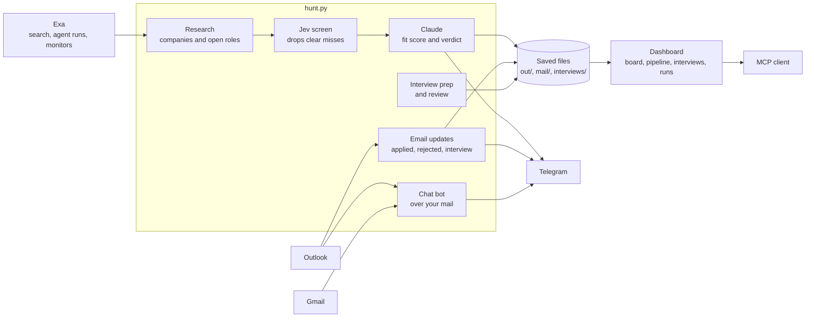

# Job hunt

I built this job hunting app for my own job search. It uses [Exa](https://exa.ai) to find companies and research them and their open roles, and Claude to score how well each one fits my profile and CV. A short notification goes to Telegram, and a dashboard shows the full results and keeps track of my applications, email updates and interviews. It runs on a laptop, or on Railway with scheduled commands and a login, so I can use it from my phone (see [Deploy to Railway](dashboard/README.md#deploy-to-railway)).

## How it fits together



`hunt.py` is the command line and does the paid work (Exa, Jev, Claude). What it finds is saved as plain files in the data folder. The dashboard reads those files, keeps your statuses, notes and side projects in SQLite (`hunt.db`), and starts `hunt.py` commands as subprocesses, from a button, on a schedule or from an MCP client. Jev, TypeSafe's decision model, is an optional cheap screen in front of Claude. It drops only what it is confident about, and anything uncertain goes on to Claude.

## Layout

| Path | Holds | Docs |
|---|---|---|
| `hunt.py` | The CLI entry point: `python hunt.py <command>` | [Commands](#commands) |
| `clients/` | Clients for the external services the features share: Exa, TypeSafe's Jev, Ashby job boards, Telegram, PostHog | [clients/README.md](clients/README.md) |
| `pipeline/` | The job hunt: company research, Jev role screen and Claude fit scoring, Exa monitors, news digest, saved-run format and lock | [pipeline/README.md](pipeline/README.md) |
| `inbox/` | Your mailboxes: browser sign-in, Outlook and Gmail APIs, email updates, the Telegram chat bot (your mail, and news digests on request) | [inbox/README.md](inbox/README.md) |
| `interview/` | Interview files and talk metrics, Claude prep briefs and transcript reviews | [interview/README.md](interview/README.md) |
| `evals/` | Public, human-labeled AI exams: Jev role-screen runner and reproducible results | [evals/README.md](evals/README.md) |
| `dashboard/` | The dashboard app, its MCP endpoint for AI clients and its Railway deploy | [dashboard/README.md](dashboard/README.md) |
| `tests/` | The test suite and Verify in CI | [tests/README.md](tests/README.md) |
| `docs/` | Parked ideas | [docs/parked-ideas.md](docs/parked-ideas.md) |

## Setup

Requires Python 3.11+ (`tomllib`), an Exa API key ([dashboard.exa.ai](https://dashboard.exa.ai)), an Anthropic API key and a Telegram bot. A TypeSafe API key ([console.typesafe.ai](https://console.typesafe.ai/keys)) is optional: it lets the Jev decision model screen out clear misses before Claude (see [Jev screening](clients/README.md#jev-screening)).

```bash
python -m venv .venv
source .venv/bin/activate
pip install -r requirements.txt
cp .env.example .env   # then set EXA_API_KEY in .env
```

The [AI eval](evals/README.md) checks its public dataset without keys (`python -m evals roles`). Its explicit `--live` mode needs only `TYPESAFE_API_KEY` exported in the environment; it does not load `.env` or read your private files.

Smoke test (searches "what is exa.ai" and prints 3 results with highlights):

```bash
python -m clients.exa_client
```

## Configure

1. Add keys to `.env`: `EXA_API_KEY`, `ANTHROPIC_API_KEY`, `TELEGRAM_BOT_TOKEN`, `TELEGRAM_CHAT_ID` (see `.env.example` for how to get the Telegram values), and optionally `TYPESAFE_API_KEY` (see [Jev screening](clients/README.md#jev-screening)), `LOGFIRE_TOKEN` (traces of the chat bot's answers, without their text; see [Chat with your mail](inbox/README.md#chat-with-your-mail)) and `POSTHOG_PROJECT_TOKEN` with `POSTHOG_HOST` (analytics and observability in your PostHog project: what you do on the dashboard and the pages you open there, each call of its MCP endpoint's tools, each command and each model call, without anything they read or wrote; see [PostHog](clients/README.md#posthog)). The dashboard can also show PostHog Support's chat widget, which does send what you type in it: off unless you set `POSTHOG_SUPPORT_WIDGET=1` in its environment (see [Support widget](dashboard/README.md#support-widget)).
2. `cp profile.example.toml profile.toml`. `[search].roles`, `seniority` and `work_mode` are required (a command exits with `[search].<key> is required` otherwise). Under `[candidate]`, set `location` and point `cv_file` at your CV (`cp cv.example.md cv.md`, then edit; leave out contact details). The CV text is sent to the scoring model, never to Exa or Telegram. Without a CV or `experience`, fit is scored on role, seniority and location criteria only. `location` is used to judge whether "remote" roles are open to you (for example, US-only remote is not a fit). `notes` (preferences or deal-breakers) and `weak_spots` are also sent to the scorer (see Weak spots in [Run](pipeline/README.md#run)); optionally fill `gaps` (see Stretch in [Run](pipeline/README.md#run)).
3. `cp companies.example.csv companies.csv` and list `name,domain` rows (the domain disambiguates similarly named companies). Domains are normalised as in `discover` and the dashboard: `https://`, `http://`, `www.` and any path after the host are stripped. A row whose domain still contains a `/` or has no `.` stops the run before any paid call, with the row named. A domain listed twice (case-insensitive) is researched once, with a warning. A file saved by Excel as "CSV UTF-8" (with a byte-order mark) is read as is.
4. Optional: `[news].topics` in `profile.toml` for the news digest (scheduled, or when you ask the chat bot for news), `monitors.csv` (`cp monitors.example.csv monitors.csv`, `name,domain` rows, or add, edit and remove them under Monitors on the dashboard's Runs page) for the few companies whose new postings Exa should watch for you, and an Outlook sign-in for email updates (see [News digest](pipeline/README.md#news-digest), [Monitors](pipeline/README.md#monitors) and [Email updates](inbox/README.md#email-updates)). A profile that still has `[monitor].companies` from before stops `monitor-sync` until those companies are moved to `monitors.csv`; a `[watch]` table is no longer read. Fiber's jobs database as an extra source of open roles is chosen per run, not here: `run --fiber`, or **With Fiber** on the dashboard's Runs page (see Role search in [Run](pipeline/README.md#run); it costs more per company).

## Commands

`python hunt.py <command> --help` lists each command's options. "Paid calls" are the APIs a command pays for; Jev is used only with `TYPESAFE_API_KEY` set.

| Command | What it does | Paid calls | Telegram | Details |
|---|---|---|---|---|
| `python hunt.py discover` | Suggests new companies to research | Exa | No | [Run](pipeline/README.md#run) |
| `python hunt.py run` | Researches and scores every company in `companies.csv` | Exa, Jev, Claude (and an Exa agent run with Fiber per company with `--fiber`) | Yes, unless `--dry-run` or `--research-only` | [Run](pipeline/README.md#run) |
| `python hunt.py send` | Sends a saved run's notification again | No | Yes | [Run](pipeline/README.md#run) |
| `python hunt.py monitor-sync` | Creates, updates and deletes the Exa monitors to match `monitors.csv` | None by itself; Exa then bills each monitor's runs ($0.002 a run, two a day) | No | [Monitors](pipeline/README.md#monitors) |
| `python hunt.py monitor` | Suitable new postings the monitors found since the last check | Jev, Claude (Exa only for an unclear link or a missing posting text) | Yes, unless `--dry-run` | [Monitors](pipeline/README.md#monitors) |
| `python hunt.py outlook-login` | Signs in to Outlook once | No | No | [Email updates](inbox/README.md#email-updates) |
| `python hunt.py mail` | Application confirmations, rejections and interview invites in new email | Jev, Claude | Yes, unless `--dry-run` | [Email updates](inbox/README.md#email-updates) |
| `python hunt.py news` | News digest on your `[news].topics` | Exa, Jev, Claude | Yes, unless `--dry-run` | [News digest](pipeline/README.md#news-digest) |
| `python hunt.py interview-prep` | Prep brief for one interview | Claude (and Exa for the posting) | No | [Interviews](interview/README.md#interviews) |
| `python hunt.py interview-review` | Review of one interview's transcript | Claude | No | [Interviews](interview/README.md#interviews) |
| `python hunt.py gmail-login` | Signs in to Gmail once | No | No | [Chat with your mail](inbox/README.md#chat-with-your-mail) |
| `python hunt.py chat` | Telegram chat bot over your mail; makes a news digest when you ask for news | Claude; Exa and Jev for a news digest | Yes, it answers in Telegram | [Chat with your mail](inbox/README.md#chat-with-your-mail) |
| `python -m dashboard` | Dashboard: results, tracking, starting jobs; with `MCP_TOKEN`, the same as tools for AI clients at `/mcp` | Only the jobs you start | Only the jobs you start | [Dashboard](dashboard/README.md#dashboard), [MCP endpoint](dashboard/README.md#mcp-endpoint) |
| `python -m evals roles` | Validate the public Jev keep/drop exam; `--dataset FILE` selects a frozen exam, `--live --output NEW_DIRECTORY` scores it and saves reports | No by default; Jev with `--live` | No | [AI evaluations](evals/README.md) |
| `python -m pytest` | Test suite, no keys and no network | No | No | [Tests](tests/README.md#run-the-tests) |

## Files

| File | Purpose |
|---|---|
| `requirements.txt` | Pinned dependencies (`exa-py`, `python-dotenv`, `anthropic`, `pydantic`, `requests`, `pydantic-ai-slim[anthropic,logfire]` and `logfire` for the chat bot and its traces, `fastapi`, `uvicorn`, `jinja2`, `python-multipart` for the dashboard, `mcp` for its MCP endpoint, and `posthog` with the OpenTelemetry packages its log export uses (`opentelemetry-api`, `opentelemetry-sdk`, `opentelemetry-exporter-otlp-proto-http`)) |
| `requirements-dev.txt` | Test dependencies (`pytest`, `responses`, `httpx` for FastAPI's `TestClient`, `PyYAML` for the Verify workflow test) |
| `pytest.ini` | pytest settings: test paths and options |
| `evals/data/roles*.json`, `evals/sessions/`, `evals/results/<run>/` | Public synthetic/real-posting exams, source-backed owner-labeling records, and selected live result directories with per-case evidence and Markdown reports |
| `Dockerfile`, `.dockerignore` | Dashboard image for Railway; private files are kept out of it |
| `.github/workflows/ci.yml` | GitHub Actions: run the tests on pull requests and pushes to `main` |
| `.github/workflows/verify.yml` | GitHub Actions: the `verify` skill on a pull request labelled `verify` (see [Verify in CI](tests/README.md#verify-in-ci)) |
| `AGENTS.md` | Instructions for coding agents working in this repo |
| `.claude/skills/verify/` | Independent verification: one full review and one focused follow-up, then owner approval for further review; draft PRs may precede completion, never merge readiness. `/verify <intent>` and follow-up usage: [verification process](tests/README.md#independent-verification). `scripts/sandbox.py` serves sample data with a fake `hunt.py`; `scripts/ci.py` runs one opt-in full review and rejects incomplete evidence (see [Verify in CI](tests/README.md#verify-in-ci)). |
| `.claude/skills/posthog/` | `posthog` skill: what a change has to add for PostHog (an event for a new dashboard action, a generation for a new model call, the records of a new command), what may never be sent, and how to test it. Agents follow it whenever they add or change a feature; the `verify` skill checks it |
| `.claude/skills/visualize-changes/` | `/visualize-changes`, run only when you ask: an offline HTML briefing with the takeaway first, a selectable system map, before/after behavior and related files; explicit relationships, dashboard captures, review notes and git facts (no diff), saved in `.change-reports/` (git-ignored) |
| `docs/parked-ideas.md` | Ideas not built yet |
| `.env.example` | Template for required environment variables |
| `.env` | Local secrets (git-ignored) |
| `profile.example.toml` | Template for `profile.toml` (git-ignored) |
| `cv.example.md` | Template for `cv.md` (git-ignored) |
| `companies.example.csv` | Template for `companies.csv` (git-ignored) |
| `monitors.example.csv` | Template for `monitors.csv` (git-ignored): the companies `monitor-sync` keeps an Exa monitor for |
| `out/` | Raw per-run JSON results (git-ignored) |
| `discovered.csv` | History of every company `discover` has suggested (git-ignored) |
| `watch_state.json` | Postings the removed watch list reported (git-ignored); still read so those you track on Pipeline keep their titles |
| `monitor_state.json` | Your Exa monitors, the last run read of each and the postings already judged (git-ignored) |
| `hunt.db` | Dashboard database: copies of the files above plus your statuses, notes, side projects, job history, answers to email suggestions and the applications you added from email (git-ignored; back it up with the dashboard stopped, since its `hunt.db-wal` and `hunt.db-shm` sidecars hold the newest changes until a checkpoint) |
| `outlook_token.json` | Your Outlook sign-in, from `outlook-login` (git-ignored; gives read access to your mail and lets drafts be created) |
| `gmail_token.json` | Your Gmail sign-in, from `gmail-login` (git-ignored; same access) |
| `mail/` | Application confirmations, rejections and interview invites `mail` found, one file per check that found some (git-ignored) |
| `mail_state.json` | When mail was last checked and the emails already labelled (git-ignored) |
| `news_state.json` | Articles the news digest has already considered; the empty `news_state.json.lock` next to it is what its two writers, `news` and the chat bot, lock while they update it (git-ignored) |
| `jobs/` | Logs and company lists of jobs started from the dashboard (git-ignored) |
| `interviews/` | Your interviews: details, transcripts, prep briefs and reviews (git-ignored) |
| `.hunt.lock` | Lock file that lets one `hunt.py` command run at a time (git-ignored) |
